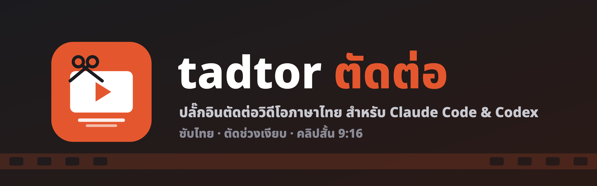

<div align="center">



**Edit videos by chatting in Thai: silence cutting, Thai subtitles (incl. CapCut-style 1/2/3-word captions), HyperFrames motion graphics, CapCut Web browser control, and vertical shorts for Claude Code & Codex.**

 

[](LICENSE)
[](https://github.com/Boom-Vitt/tadtor/actions)
[](https://code.claude.com/docs/en/plugins)
[](https://developers.openai.com/codex)

[ไทย](README.md) · **English**

</div>

---

*tadtor* (ตัดต่อ) means "to edit" in Thai. Most AI video tooling assumes English, and Thai breaks it: Thai has no spaces between words, so subtitles get cut mid-word, and vowel/tone marks get counted toward line width. This plugin packages the Thai-specific know-how as agent skills on top of plain `ffmpeg` + Whisper. Everything runs locally.

## Skills

| Skill | What it does |
|---|---|
| `thai-subtitles` | Transcribe Thai speech → SRT → word-aware line breaking (`pythainlp`) → proofread → burn in with a Thai font |
| `cut-silence` | Remove silences automatically, plus Thai filler words (เอ่อ/อ่า/อืม) and retakes from word timestamps |
| `edit-video` | Raw footage → finished MP4, chaining the other skills; pauses only to confirm cuts and review the draft |
| `thai-motion` | HyperFrames motion graphics: kinetic Thai title, lower third, word-by-word karaoke captions, punch-in zooms with push-in depth, progress bar, CTA, bundled Kanit font |
| `capcut` | Drive CapCut Web through browser control: upload footage, import Thai subtitles 1/2/3 words at a time, apply styles, Thai fonts and caption animations to all clips. Ships a UI map + JS helpers so the agent doesn't re-explore the page (saves tokens). Export needs the user to sign in |
| `thai-shorts` | Find highlights in a long video → cut to 9:16 → big captions → Thai titles & hashtags; YouTube chapters |

## Install

```bash
# Claude Code
claude plugin marketplace add Boom-Vitt/tadtor
claude plugin install tadtor@tadtor

# Codex
codex plugin marketplace add Boom-Vitt/tadtor
codex plugin add tadtor@tadtor
```

Other agents: copy `skills/*` into that agent's skills folder.

**Requirements:** `ffmpeg`, Python 3.9+, Node.js 22+ (HyperFrames via `npx`), a Whisper CLI with a large-v3-turbo or larger model (`whisper-cpp` or `mlx-whisper`), and `pythainlp` (recommended).

Tested end to end on a Mac mini M4: 26.0 s raw clip → 18.8 s after silence cut → Thai transcription in 2.4 s → `hyperframes check` passed → 1080p render in 28 s.

## Contributing

PRs welcome. Run `python3 tests/test_scripts.py` and `claude plugin validate .` before opening one.

## Credits

[HyperFrames](https://github.com/heygen-com/hyperframes) (HeyGen), [PyThaiNLP](https://github.com/PyThaiNLP/pythainlp), [Kanit](https://github.com/cadsondemak/kanit) font (OFL), [whisper.cpp](https://github.com/ggml-org/whisper.cpp), FFmpeg.

## License

[MIT](LICENSE)
