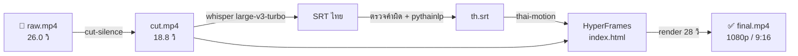

<!-- BBN:HEADER:START -->
<div align="center">


<a href="https://github.com/Boom-Vitt/tadtor/stargazers"></a>
<a href="https://github.com/Boom-Vitt/tadtor/commits/main"></a>
<a href="https://github.com/Boom-Vitt"></a>

</div>
<!-- BBN:HEADER:END -->

<div align="center">


<br>

**สั่งตัดต่อวิดีโอเป็นภาษาไทย ให้ AI ตัดช่วงเงียบ ทำซับไทย (ทีละ 1-2-3 คำแบบ CapCut) ใส่โมชั่นกราฟิก คุม CapCut ผ่านเบราว์เซอร์ และ export คลิปพร้อมโพสต์ให้จบในแชตเดียว**

[](LICENSE)
[](https://github.com/Boom-Vitt/tadtor/actions)
[](https://code.claude.com/docs/en/plugins)
[](https://developers.openai.com/codex)
[](https://ffmpeg.org)
[](https://github.com/heygen-com/hyperframes)
[](https://www.capcut.com/editor)
[](https://github.com/Boom-Vitt/tadtor/stargazers)

**ไทย** · [English](README.en.md)

[เดโม](#-เดโม) · [ติดตั้ง](#-ติดตั้ง) · [ความสามารถ](#-ความสามารถ) · [ตัวอย่างคำสั่ง](#-ตัวอย่างคำสั่ง) · [ร่วมพัฒนา](#-ร่วมพัฒนา)

</div>

---

## 🤔 ทำไมต้อง tadtor

AI ตัดต่อทั่วไปถูกออกแบบมาสำหรับภาษาอังกฤษ พอเจอภาษาไทยก็มีปัญหาเดิมๆ:

- **ซับไทยขาดกลางคำ** เพราะภาษาไทยไม่เว้นวรรคระหว่างคำ
- **นับความยาวบรรทัดผิด** เพราะนับสระบน/ล่างและวรรณยุกต์เป็นตัวอักษรด้วย
- **ถอดเสียงไม่ได้ `--language th`** เลยกลายเป็นภาษาอังกฤษเมื่อพูดทับศัพท์เยอะ
- **ตัด "เอ่อ อ่า อืม" ไม่ได้** เพราะไม่รู้จักคำเติมภาษาไทย

tadtor รวมความรู้ตรงนี้ไว้เป็น skills ที่ Claude Code และ Codex ใช้ได้ทันที ข้างในเป็นแค่ `ffmpeg` + Whisper + [HyperFrames](https://github.com/heygen-com/hyperframes) + สคริปต์ Python สั้นๆ ทำงานในเครื่องทั้งหมด ไม่ต้องอัปโหลดวิดีโอขึ้นคลาวด์

## 🎬 เดโม

ทุกอย่างในคลิปนี้ทำโดยปลั๊กอิน จากไฟล์เสียงพูดดิบ 26 วินาทีที่มีช่วงเงียบและคำว่า "เอ่อ":

<table>
<tr>
<td width="72%"></td>
<td width="28%"></td>
</tr>
</table>



| ขั้น | ผลจริงจากการทดสอบ (Mac mini M4) |
|---|---|
| ตัดช่วงเงียบ | 26.0 → 18.8 วินาที (ตัดออก 7.2 วิ) |
| ถอดเสียงไทย | 2.4 วินาที, แก้คำผิด 6 จุด (เช่น "พาศาทาย" → ภาษาไทย) |
| `hyperframes check` | ผ่าน, contrast 49/49 |
| Render 1920×1080 | 28 วินาที, 9.1 MB |

### ซับทีละ 1 · 2 · 3 คำ (แบบ CapCut)

```bash
python3 skills/thai-subtitles/scripts/thai_srt.py th.srt --words 2 -o capcut-2w.srt
```

| `--words 1` | `--words 2` | `--words 3` |
|---|---|---|
| สวัสดี · ค่ะ · ทุกคน · วันนี้ | สวัสดีค่ะ · ทุกคน วันนี้ · เราจะ | สวัสดีค่ะทุกคน · วันนี้เราจะ · มาลองตัดต่อ |

ตัดคำด้วย PyThaiNLP ไม่ขาดกลางคำ ใช้ได้ 2 ทาง: นำเข้า CapCut (skill `capcut`) หรือเรนเดอร์เองด้วย HyperFrames (`thai_motion.py --words 1`)

> [!NOTE]
> ทดสอบกับ CapCut Web จริงแล้ว (17 ก.ย. 2026): นำเข้า SRT ทีละ 2 คำ → สไตล์ป้ายเหลือง → ฟอนต์ `ใบจามจุรี-Bd` → แอนิเมชัน `Pop-Up Combo` ใช้กับทุกซับ ทำได้ในโหมด guest แต่ **การ export ต้องล็อกอิน CapCut เอง** (AI จะไม่ล็อกอินแทน)

### ซับไทยก่อน / หลัง

<table>
<tr><th>❌ ตัดบรรทัดตามความยาวอย่างเดียว</th><th>✅ ผ่าน <code>thai_srt.py</code></th></tr>
<tr><td>

```
เอ่อ สวัสดีครับทุกคน วันนี้
เราจะมาสอนตัดต่อวิดีโอภา
ษาไทยด้วยปัญญาประดิษฐ์แบ
บง่ายๆ กันนะครับ
```

</td><td>

```
สวัสดีครับทุกคน วันนี้เราจะ
มาสอนตัดต่อวิดีโอภาษาไทย

ด้วยปัญญาประดิษฐ์แบบง่ายๆ
กันนะครับ
```

</td></tr>
</table>

## ✨ ความสามารถ

| Skill | ทำอะไร | ลองพิมพ์ |
|---|---|---|
| 🎞️ **`thai-subtitles`** | ถอดเสียงไทย → SRT → จัดบรรทัดตามคำ → ตรวจคำผิด → ฝังซับด้วยฟอนต์ไทย | *"ทำซับไทยให้ vlog.mp4 ฟอนต์ Kanit"* |
| ✂️ **`cut-silence`** | ตัดช่วงเงียบอัตโนมัติ, ตัดคำว่า เอ่อ/อ่า/อืม และประโยคที่พูดซ้ำ | *"ตัดช่วงเงียบกับคำว่าเอ่อออกจาก podcast.mp4"* |
| 🎬 **`edit-video`** | ทำครบทุกขั้นตอน ตั้งแต่ฟุตเทจดิบจนได้ไฟล์ mp4 พร้อมโพสต์ | *"ตัดต่อ raw.mp4 ให้พร้อมลง YouTube"* |
| ✨ **`thai-motion`** | โมชั่นกราฟิกด้วย HyperFrames: ไตเติ้ลเด้งทีละคำ, lower third, ซับคาราโอเกะ, ซูม punch-in + push-in มีมิติ, progress bar, CTA | *"ใส่ซับเด้ง ไตเติ้ล กับชื่อคนพูดให้ cut.mp4"* |
| 🎛️ **`capcut`** | คุม CapCut Web ผ่านเบราว์เซอร์: อัปโหลดคลิป, นำเข้าซับทีละ 1-2-3 คำ, ใส่สไตล์/ฟอนต์ไทย/แอนิเมชันให้ทุกซับ, มีแผนที่ UI + JS helper ให้ AI ไม่ต้องสำรวจหน้าจอใหม่ทุกครั้ง | *"เอาคลิปนี้เข้า CapCut ซับทีละ 2 คำ สไตล์ป้ายเหลือง เด้งขึ้น"* |
| 📱 **`thai-shorts`** | หาช่วงเด็ดจากคลิปยาว → ตัดเป็น 9:16 → ซับตัวใหญ่ → เขียนแคปชัน/แฮชแท็กไทย, ทำ YouTube chapters | *"หา 3 ช่วงเด็ดจาก live.mp4 ทำเป็น TikTok"* |

> [!TIP]
> พิมพ์สั้นๆ ว่า *"ตัดต่อคลิปนี้ให้หน่อย"* ก็พอ skill `edit-video` จะเรียก skill อื่นต่อกันเอง และหยุดถามแค่ 2 จุด คือตอนยืนยันส่วนที่จะตัด และตอนดู draft

## 📦 ติดตั้ง

<details open>
<summary><b>Claude Code</b></summary>

```bash
claude plugin marketplace add Boom-Vitt/tadtor
claude plugin install tadtor@tadtor
```

หรือพิมพ์ในแชต Claude Code: `/plugin marketplace add Boom-Vitt/tadtor` แล้ว `/plugin install tadtor@tadtor`

</details>

<details open>
<summary><b>Codex</b></summary>

```bash
codex plugin marketplace add Boom-Vitt/tadtor
codex plugin add tadtor@tadtor
```

</details>

<details>
<summary><b>เครื่องมืออื่น (Cursor, Gemini CLI ฯลฯ) หรือใช้แค่ skills</b></summary>

คัดลอกโฟลเดอร์ใน [`skills/`](skills) ไปไว้ที่โฟลเดอร์ skills ของเครื่องมือนั้น เช่น `~/.claude/skills/`, `~/.codex/skills/` หรือ `.agents/skills/` ในโปรเจกต์

```bash
git clone https://github.com/Boom-Vitt/tadtor
cp -r tadtor/skills/* ~/.claude/skills/
```

</details>

### สิ่งที่ต้องมีในเครื่อง

| โปรแกรม | จำเป็น | ติดตั้ง (macOS) |
|---|---|---|
| `ffmpeg` (มี libass สำหรับฝังซับ) | ✅ | `brew install ffmpeg-full` |
| Python 3.9+ | ✅ | มีอยู่แล้วบน macOS |
| Browser control (Claude in Chrome / Playwright MCP) | สำหรับ skill `capcut` | ติดตั้ง extension ของเครื่องมือที่ใช้ |
| Node.js 22+ | สำหรับโมชั่นกราฟิก | `brew install node` (HyperFrames รันผ่าน `npx` ไม่ต้องติดตั้งเพิ่ม) |
| Whisper ตัวใดตัวหนึ่ง (โมเดล large-v3-turbo ขึ้นไป) | สำหรับถอดเสียง | `brew install whisper-cpp` หรือ `pip install mlx-whisper` |
| `pythainlp` | แนะนำมาก | `pip install pythainlp` |
| ฟอนต์ไทย | มากับปลั๊กอินแล้ว | ฟอนต์ Kanit (OFL) สำหรับโมชั่นกราฟิก |

> [!NOTE]
> ไม่ต้องติดตั้งเองทั้งหมดก็ได้ AI จะเช็กและบอกว่าขาดอะไรตอนเริ่มใช้งาน

## 💬 ตัวอย่างคำสั่ง

```text
ทำซับไทยให้ interview.mp4 แก้ชื่อ "คุณสมชาย" กับ "Claude" ให้สะกดถูก แล้วฝังซับสีขาวขอบดำ
```

```text
ตัดช่วงเงียบใน tutorial.mov ให้กระชับ แต่อย่าตัดท้ายคำ ขอดูก่อนว่าจะตัดกี่วินาที
```

```text
podcast-ep12.mp4 ยาว 1 ชั่วโมง หาช่วงที่น่าจะไวรัล 5 ช่วง ทำเป็น Reels พร้อมแคปชัน
```

```text
ใส่ไตเติ้ล "รีวิว iPhone 18" ชื่อ "บูม" ตำแหน่ง "Tech Reviewer" ซับเด้งสีเหลือง แล้ว render แนวตั้งด้วย
```

```text
ทำ YouTube chapters ภาษาไทยให้ lecture.mp4
```

## 🧰 ใช้สคริปต์เองโดยไม่ผ่าน AI

```bash
# จัดบรรทัดซับไทย (30 ตัวต่อบรรทัด, สูงสุด 2 บรรทัด, ลบ เอ่อ/อ่า/อืม)
python3 skills/thai-subtitles/scripts/thai_srt.py in.srt -o out.srt --max-chars 30 --strip-fillers

# ดูว่าจะตัดช่วงเงียบตรงไหน แล้วค่อย render
python3 skills/cut-silence/scripts/cut_silence.py in.mp4 --dry-run
python3 skills/cut-silence/scripts/cut_silence.py in.mp4 -o out.mp4 --noise -35 --pad 0.15

# สร้างโปรเจกต์โมชั่นกราฟิก แล้ว render ด้วย HyperFrames
python3 skills/thai-motion/scripts/thai_motion.py out.mp4 --srt th.srt -o motion \
  --title "หัวเรื่อง" --name "ชื่อ" --role "ตำแหน่ง" --zoom 7.2,15 --cta "กดติดตามด้วยนะ"
cd motion && npx hyperframes check && npx hyperframes render --quality high --output final.mp4
```

## 🗂️ โครงสร้าง

```
tadtor/
├── .claude-plugin/        # manifest สำหรับ Claude Code
├── .codex-plugin/         # manifest สำหรับ Codex
├── .agents/plugins/       # marketplace สำหรับ Codex
├── skills/
│   ├── edit-video/        # SKILL.md (ทำครบทุกขั้นตอน)
│   ├── cut-silence/       # SKILL.md + scripts/cut_silence.py
│   ├── thai-subtitles/    # SKILL.md + scripts/thai_srt.py
│   ├── thai-motion/       # SKILL.md + scripts/thai_motion.py + assets/fonts (Kanit)
│   ├── capcut/            # SKILL.md (แผนที่ UI CapCut Web + JS helpers)
│   └── thai-shorts/       # SKILL.md
└── tests/test_scripts.py  # python3 tests/test_scripts.py
```

## 🗺️ แผนต่อไป

- [x] ซับคาราโอเกะ (ไฮไลต์ทีละคำ) สำหรับคลิปสั้น
- [x] โมชั่นกราฟิกด้วย HyperFrames
- [x] ซับทีละ 1-2-3 คำ + คุม CapCut Web ผ่านเบราว์เซอร์
- [ ] export draft ไปแอป CapCut desktop โดยตรง
- [ ] จับเวลาต่อคำจาก word timestamps จริง (ตอนนี้ประมาณจากความยาวคำ)
- [ ] ธีมโมชั่นหลายแบบ + เพลงประกอบพร้อม ducking
- [ ] แปลซับ ไทย ⇄ อังกฤษ
- [ ] ตรวจจับใบหน้าเพื่อ crop 9:16 อัตโนมัติ
- [ ] export timeline ไป DaVinci Resolve / Premiere (EDL/FCPXML)

มีไอเดีย? [เปิด issue](https://github.com/Boom-Vitt/tadtor/issues) ได้เลย

## 🤝 ร่วมพัฒนา

ยินดีรับ PR ทุกขนาด ตั้งแต่แก้คำผิดใน SKILL.md ไปจนถึงเพิ่ม skill ใหม่

1. Fork แล้วสร้าง branch
2. แก้ไข แล้วรัน `python3 tests/test_scripts.py`
3. ถ้าแก้ manifest ให้รัน `claude plugin validate .`
4. เปิด PR อธิบายว่าแก้อะไร (ภาษาไทยหรืออังกฤษก็ได้)

skill ที่ดีควร: สั้น, บอกคำสั่งที่รันได้จริง, บอกว่าเมื่อไหร่ต้องถามผู้ใช้ก่อน, และไม่เขียนทับไฟล์ต้นฉบับ

## ⭐ Star History

<a href="https://star-history.com/#Boom-Vitt/tadtor&Date">
  <picture>
    <source media="(prefers-color-scheme: dark)" srcset="https://api.star-history.com/svg?repos=Boom-Vitt/tadtor&type=Date&theme=dark">
    
  </picture>
</a>

## 👥 ผู้ร่วมพัฒนา

<a href="https://github.com/Boom-Vitt/tadtor/graphs/contributors">
  
</a>

## 🙏 เครดิต

- [HyperFrames](https://github.com/heygen-com/hyperframes) โดย HeyGen: เรนเดอร์วิดีโอจาก HTML
- [PyThaiNLP](https://github.com/PyThaiNLP/pythainlp): ตัดคำภาษาไทย
- [Kanit](https://github.com/cadsondemak/kanit) โดย Cadson Demak: ฟอนต์ไทย (SIL OFL 1.1)
- [whisper.cpp](https://github.com/ggml-org/whisper.cpp), [FFmpeg](https://ffmpeg.org)

## 📄 License

[MIT](LICENSE) ใช้ แก้ แจก ได้ฟรี รวมถึงงานเชิงพาณิชย์ (ฟอนต์ Kanit ใช้สัญญาอนุญาต [OFL](skills/thai-motion/assets/fonts/OFL.txt))

<div align="center">
<sub>ทำด้วย ❤️ เพื่อคนทำคอนเทนต์ไทย · ถ้ามีประโยชน์ ฝากกด ⭐ ด้วยนะครับ</sub>
</div>

<!-- BBN:FOOTER:START -->
---

<div align="center">

**สร้างโดย [BoomBigNose](https://github.com/Boom-Vitt)** · [Kruoop.com](https://kruoop.com) แหล่งเรียน AI + คอมมูนิตี้ · [Seeneo.ai](https://seeneo.ai) · [YouTube 220K](https://www.youtube.com/@BoomBigNose)

<sub>ถ้าโปรเจกต์นี้มีประโยชน์ กด ⭐ ให้กำลังใจกันได้เลย</sub>

</div>
<!-- BBN:FOOTER:END -->
